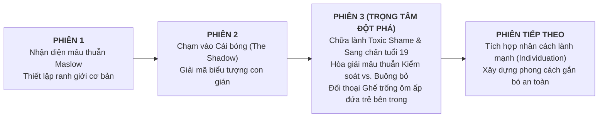

# KẾ HOẠCH & MỤC TIÊU THAM VẤN CHUYÊN SÂU - PHIÊN 3
### THÂN CHỦ: ĐẶNG HUYỀN PHƯƠNG | MÃ HỒ SƠ: SC131026003
*(Nhà tham vấn: Trần Thiện – Căn cứ: Lịch sử Phiên 1, Thư 10 trang, Diễn biến Phiên 2 và Khung chuyên môn DK)*

---

---

## I. MỤC TIÊU TỔNG QUÁT (GENERAL CLINICAL GOAL)
Giúp thân chủ chuyển hóa từ **Trí thức hóa lý trí (*Intellectualization*)** sang **kết nối và chữa lành cảm xúc thực tế**; giải tỏa tận gốc cảm giác **Xấu hổ độc hại (*Toxic Shame*)** bắt nguồn từ quá khứ nợ nần và mối quan hệ thao túng năm 19 tuổi; hòa giải mâu thuẫn giữa nhu cầu kiểm soát ngoài đời thực và khao khát được buông bỏ/phục tùng trong đời sống riêng tư; thực hành kỹ thuật trải nghiệm (*Experiential technique*) để ôm ấp "phần con gián chui rúc", tiến tới sự tự chấp nhận vô điều kiện.

---

## II. 4 MỤC TIÊU CHUYÊN BIỆT & KẾ HOẠCH TRIỂN KHAI CHI TIẾT

### 1. Nghiệm thu & Lượng giá sự chuyển hóa từ Bài tập về nhà
* **Nội dung làm việc:**
  - Rà soát việc thực hành **2 khoảnh khắc ghi nhận bản thân mỗi ngày**: Thân chủ có cảm thấy ngượng ngùng, kháng cự hay bối rối khi tự khen chính mình không? Mức độ phụ thuộc vào sự công nhận bên ngoài đã giảm bớt ra sao?
  - Phân tích trải nghiệm **Lắng nghe chánh niệm với bạn bè**: Thân chủ đã nhận diện cơn thôi thúc muốn "đưa ra giải pháp / tranh luận / chứng minh năng lực" như thế nào? Cảm giác nhẹ nhõm khi buông bỏ khiên chắn trí thức hóa?
  - Khám phá nhật ký **The Shadow (4 từ khóa con gián)**: Những cảm xúc và ký ức nào đã trào dâng khi thân chủ đọc các lời khẳng định giải thoát?
* **Kỹ thuật:** Phỏng vấn khơi mở, phản ánh cảm xúc (*Emotional Reflection*).

---

### 2. Bóc tách Sang chấn năm 19 tuổi & Cơ chế Chấn thương gắn bó (Trauma Bonding)
* **Nội dung làm việc:**
  - Đi sâu vào mối quan hệ với người đàn ông ái kỷ năm 19 tuổi: Giải mã vì sao những lời khen của anh ta lại có sức mạnh mở tung "chiếc rương kho báu" và khiến em bị lệ thuộc cảm xúc sâu sắc *(bản chất: đánh trúng cơn khát được nhìn thấy và công nhận của đứa trẻ bị khinh khi thời thơ ấu)*.
  - Phân định rõ ràng: Thân chủ là nạn nhân của sự thao túng và thiếu kinh nghiệm tuổi mới lớn. Tách rời hành vi lợi dụng tình dục của đối phương ra khỏi phẩm giá và sự trong sạch của thân chủ.
  - **Nghi thức chuyển giao cảm xúc:** Trả lại toàn bộ sự xấu hổ, tội lỗi và nhơ nhuốc cho kẻ gây hại; thu hồi sự tự tôn, trong sạch và tôn nghiêm về lại cho chính mình.
* **Liệu pháp:** Tâm lý học Tâm động học (*Psychodynamic Therapy*) & Liệu pháp Tập trung vào Trắc ẩn (*CFT*).

---

### 3. Hòa giải mâu thuẫn giữa Nhu cầu Kiểm soát (Control) và Khao khát Buông bỏ (Surrender / BDSM)
* **Nội dung làm việc:**
  - Khám phá gốc rễ của nhu cầu BDSM/phục tùng: Giúp thân chủ hiểu đây không phải là sự "tầm thường/suy đồi", mà là tiếng kêu cứu của hệ thần kinh muốn được **"tắt nguồn" (Power-down)** sau những chuỗi ngày phải gánh vác trách nhiệm, tính toán và kiểm soát cuộc sống quá mức.
  - Nhận diện rủi ro: Khi chưa có cảm giác an toàn nội tại (*Inner Safety*), thân chủ dễ tìm kiếm sự "tắt nguồn" thông qua các mối quan hệ tình cảm nguy cơ cao, cường độ mạnh nhưng thiếu ổn định.
  - **Tái cấu trúc nhận thức & Hành vi:** Hướng dẫn thân chủ cách tạo dựng các "khoảng dừng buông bỏ kiểm soát an toàn" trong đời sống thường nhật (thiền định, thả lỏng cơ thể, cho phép mình vụng về/nghỉ ngơi) mà không cần phải đánh đổi bằng sự lệ thuộc tình cảm độc hại.
* **Liệu pháp:** Liệu pháp Hành vi Nhận thức (*CBT*) & Liệu pháp Chấp nhận và Cam kết (*ACT*).

---

### 4. Kỹ thuật Ghế trống (Empty Chair): Đối thoại & Ôm ấp "Đứa trẻ Chui rúc bên trong"
* **Nội dung làm việc:**
  - Thiết lập kỹ thuật thực hành trải nghiệm trực tiếp tại phòng tham vấn:
    + **Ghế 1:** Huyền Phương tuổi 21 – Người phụ nữ thông minh, độc lập, thủ khoa, biết 3 ngoại ngữ và tràn đầy nội lực sống.
    + **Ghế 2:** Huyền Phương tuổi 14 - 17 – Đứa trẻ mặc quần áo rách cũ, nghèo khó, co ro sợ hãi trốn giang hồ đòi nợ, cô độc gánh chịu tin nhắn bôi nhọ trước kỳ thi, phải "chui rúc" để sinh tồn.
  - **Tiến trình đối thoại:**
    1. Huyền Phương trưởng thành bày tỏ lòng biết ơn sâu sắc: *"Cảm ơn em vì đã biết nhẫn nại chui rúc, biết chịu đựng giông bão để bảo toàn sinh mạng và đưa chị đến thành công hôm nay."*
    2. Huyền Phương trưởng thành gửi thông điệp an toàn: *"Em không còn phải sợ hãi trốn tránh nữa. Chị đã lớn rồi, chị có đủ sức mạnh để bảo vệ em. Từ nay em hoàn toàn an toàn để bước ra ánh sáng."*
    3. Hóa giải chiếc bẫy chứng minh: *"Em không cần phải làm thủ khoa hay trở thành người vĩ đại mới xứng đáng được yêu thương. Kể cả khi em yếu đuối, chị vẫn yêu thương và che chở cho em vô điều kiện."*
* **Liệu pháp:** Liệu pháp Gestalt (*Empty Chair Technique*) & Tâm lý học Phân tích Jung (*Active Imagination*).

---

## III. BẢNG MỤC TIÊU ĐIỀN TRÊN CRM SUNNYCARE CHO PHIÊN 3

Khi bắt đầu phiên 3, các mục cốt lõi trên CRM SunnyCare sẽ được thiết lập như sau:

| Trường trên CRM | Nội dung định hướng chuẩn mực |
| :--- | :--- |
| **Mục tiêu phiên (*)** | Chuyển hóa từ trí thức hóa sang kết nối cảm xúc thực tế; giải tỏa cảm giác Xấu hổ độc hại (Toxic Shame) từ biến cố nợ nần và mối quan hệ tuổi 19; thực hành kỹ thuật Ghế trống để ôm ấp "phần con gián chui rúc", hòa giải mâu thuẫn giữa nhu cầu kiểm soát ngoài đời và khao khát buông bỏ trong tình cảm. |
| **Liệu pháp / Test (*)** | Liệu pháp Gestalt (Kỹ thuật Ghế trống Empty Chair); Tâm lý học Phân tích (The Shadow & Active Imagination); Liệu pháp Tập trung vào Trắc ẩn (CFT); Liệu pháp Tâm động học. |
| **Kết quả mong đợi (*)** | Thân chủ tháo gỡ tận gốc cảm giác ghê tởm tự thân; chấm dứt cơ chế tự trừng phạt; cảm nhận được sự an toàn nội tại và bắt đầu cho phép mình được yếu đuối, được nghỉ ngơi mà không còn cảm giác tội lỗi. |
| **Mục tiêu phiên kế tiếp (Phiên 4)** | Chuyển đổi phong cách Gắn bó lo âu (Anxious Attachment) sang Gắn bó an toàn (Secure Attachment); tái cấu trúc tiêu chuẩn chọn lựa bạn đời/mối quan hệ dựa trên sự tôn trọng, minh bạch thay vì cường độ cảm xúc độc hại. |
