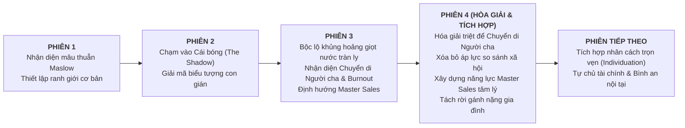

# KẾ HOẠCH & MỤC TIÊU THAM VẤN CHUYÊN SÂU - PHIÊN 4
### THÂN CHỦ: ĐẶNG HUYỀN PHƯƠNG | MÃ HỒ SƠ: SC131026003
*(Nhà tham vấn: Trần Thiện – Căn cứ: Diễn biến Phiên 3, Lá thư cầu cứu tâm hồn, Bức thư sau Phiên 3 và Khung lâm sàng DK)*

---

---

## I. MỤC TIÊU TỔNG QUÁT (GENERAL CLINICAL GOAL)
Giúp thân chủ **hòa giải triệt để cơ chế Chuyển di Người cha (*Father Transference*)** để dứt điểm sự ám ảnh và phụ thuộc cảm xúc vào người đàn ông cũ; lượng giá mức độ phục hồi hệ thần kinh sau khi thực hành **Bảng Checklist 10 thói quen vi mô**; xóa bỏ hoàn toàn áp lực so sánh xã hội với ngành kế toán/kiểm toán; định hình lộ trình phát triển bản ngã chuyên môn **"Master Sales bằng nghệ thuật thấu cảm tâm lý"**; đồng thời thiết lập ranh giới an toàn nội tại để **tách rời trách nhiệm bản thân khỏi gánh nặng nợ nần và kỳ vọng của gia đình**.

---

## II. 4 MỤC TIÊU CHUYÊN BIỆT & KẾ HOẠCH TRIỂN KHAI CHI TIẾT

### 1. Nghiệm thu Tiến trình & Lượng giá Sự Phục hồi Hệ thần kinh
* **Nội dung làm việc:**
  - Rà soát việc thực hành **Bảng Checklist 10 thói quen vi mô hằng ngày**: Đánh giá sự chuyển biến của các chỉ số sinh học (giấc ngủ, mức độ căng thẳng vùng cổ vai gáy, cảm giác chán nản anhedonia vào buổi chiều tối).
  - Phân tích trải nghiệm thực tế với **"Khoảng dừng 5 giây"**: Thân chủ đã nhận diện cơn thôi thúc gạt bỏ ý kiến đồng nghiệp/khách hàng ra sao? Cảm giác nhẹ nhõm khi không cần phải thắng trong cuộc đối thoại để chứng minh bản thân?
  - Lượng giá phản hồi bước đầu từ **"Nhật ký Bán hàng Thấu cảm"**: Thân chủ đã áp dụng việc phân tích nỗi sợ và nhu cầu ngầm của khách hàng như thế nào? Cảm xúc trước và sau các cuộc gọi đàm phán?
* **Kỹ thuật:** Phỏng vấn khơi mở, đo lường thang điểm lo âu GAD-7 rút gọn, phản ánh trải nghiệm thực tế (*Experiential Reflection*).

---

### 2. Hòa giải triệt để Cơ chế Chuyển di Người cha (Father Transference)
* **Nội dung làm việc:**
  - Bóc tách tận gốc rễ tâm lý: Mối quan hệ si mê, vừa yêu vừa ghét với người đàn ông thành đạt thực chất là **sự phóng chiếu khao khát được công nhận của người cha** từ thuở ấu thơ.
  - Phân tích niềm tin cốt lõi sai lệch: *"Nếu mình khiến người đàn ông ấy ngưỡng mộ và khen thưởng, nghĩa là mình đã thành công bắt bố phải công nhận giá trị của mình."*
  - Hướng dẫn thân chủ nhận ra sự thật giải thoát: Sự công nhận từ bất kỳ người đàn ông nào bên ngoài cũng không thể lấp đầy lỗ hổng tình cảm của người cha trong quá khứ. Giá trị của thân chủ là tự thân và bẩm sinh, không cần phải tiếp tục tự giày vò để tìm kiếm sự chấp thuận.
  - **Nghi thức khép lại quá khứ:** Tạ ơn người đàn ông ấy vì đã hành xử có đạo đức khi đẩy thân chủ ra xa để thức tỉnh; chính thức giải phóng hình bóng người đàn ông ấy và người cha ra khỏi sự chi phối đời sống cảm xúc hiện tại.
* **Liệu pháp:** Liệu pháp Tâm động học (*Psychodynamic Therapy*) & Liệu pháp Tái cấu trúc Nhận thức (*Cognitive Restructuring - CBT*).

---

### 3. Tích hợp Bản ngã Chuyên môn: Master Sales bằng Tâm lý học
* **Nội dung làm việc:**
  - Xóa bỏ triệt để áp lực so sánh xã hội: Giúp thân chủ nhìn thấu bản chất công việc kế toán/kiểm toán (kỹ năng quy trình bàn giấy) so với kỹ năng bán hàng thương mại B2B quốc tế (nghệ thuật kiến tạo dòng tiền và quan hệ con người).
  - Khẳng định giá trị thực chiến: Phân tích sâu sắc bài học thành công từ việc đem lại **doanh số cao vượt trội chỉ sau 2 tháng** vào công ty hóa chất mới. Rút ra các công thức tư duy và phong cách đàm phán độc bản của thân chủ.
  - Xây dựng chiến lược hành động: Hướng dẫn thân chủ kết hợp niềm đam mê tâm lý học vào kỹ năng bán hàng cấp độ Master – thấu cảm nỗi sợ rủi ro của đối tác, kiến tạo sự tin tưởng tuyệt đối, biến công việc bán hàng thành hành trình phụng sự có ý nghĩa và tạo sự tự chủ tài chính bền vững.
* **Liệu pháp:** Liệu pháp Thân chủ Trọng tâm (*Person-Centered*) & Định hướng Giá trị theo ACT (*Acceptance and Commitment Therapy*).

---

### 4. Thiết lập Ranh giới An toàn Nội tại & Tách rời Gánh nặng Gia đình
* **Nội dung làm việc:**
  - Bóc tách hội chứng **"Đứa trẻ gánh tội / Người giải cứu gia đình" (*Parentification*)**: Nhận diện áp lực vô thức bắt bản thân phải trả nợ cho bố mẹ, phải làm rạng danh dòng họ để xóa bỏ nỗi nhục nghèo khó năm xưa.
  - Giúp thân chủ phân định ranh giới trách nhiệm: Nghèo khó và nợ nần là hoàn cảnh và trách nhiệm của thế hệ trước. Thân chủ có quyền yêu thương, hỗ trợ gia đình trong khả năng, nhưng **không có nghĩa vụ phải hy sinh tuổi thanh xuân, sức khỏe tinh thần và sự tự do của mình để gánh vác toàn bộ quá khứ đó**.
  - Tháo dỡ "chiếc áo giáp tướng sĩ": Cho phép cô bé 21 tuổi được sống đúng với lứa tuổi, được phép nghỉ ngơi, được phép vụng về và được tự do lựa chọn niềm hạnh phúc riêng của mình mà không còn cảm giác tội lỗi (*Guilt-free Living*).
* **Liệu pháp:** Liệu pháp Hệ thống Gia đình (*Family Systems Therapy*) & Liệu pháp Tập trung vào Trắc ẩn (*CFT*).

---

## III. BẢNG MỤC TIÊU THIẾT LẬP TRÊN CRM SUNNYCARE CHO PHIÊN 4

Khi bắt đầu phiên 4, các mục cốt lõi trên hệ thống CRM SunnyCare sẽ được thiết lập như sau:

| Trường trên CRM | Nội dung định hướng chuẩn mực lâm sàng |
| :--- | :--- |
| **Mục tiêu phiên (*)** | Lượng giá sự phục hồi thần kinh qua Checklist 10 thói quen vi mô; hòa giải triệt để cơ chế Chuyển di Người cha (Father Transference) để dứt điểm sự ám ảnh vào mối quan hệ cũ; xóa bỏ áp lực so sánh xã hội, tích hợp bản ngã chuyên môn "Master Sales bằng nghệ thuật thấu cảm tâm lý"; thiết lập ranh giới an toàn nội tại để tách rời trách nhiệm cá nhân khỏi gánh nặng nợ nần gia đình. |
| **Liệu pháp / Test (*)** | Liệu pháp Tâm động học (Psychodynamic - Father Transference Resolution); Liệu pháp Chấp nhận & Cam kết (ACT - Value-based Action); Liệu pháp Tập trung vào Lòng trắc ẩn (CFT); Liệu pháp Hành vi Nhận thức (CBT). |
| **Khuyến nghị & Bài tập (*)** | Duy trì Checklist thói quen vi mô hằng ngày; thực hành Nhật ký Bán hàng Thấu cảm cho các thương vụ lớn; bài tập viết thư giải phóng hình bóng người cha và người đàn ông cũ; rèn luyện ranh giới cá nhân khi giao tiếp với gia đình. |
